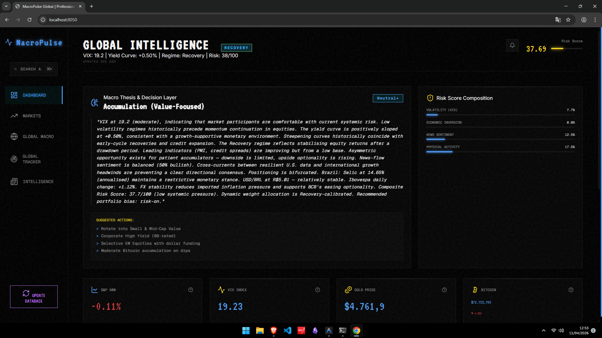
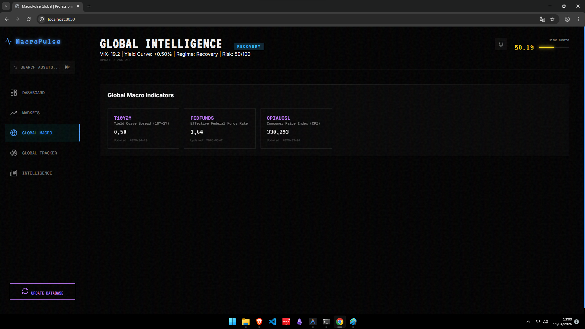
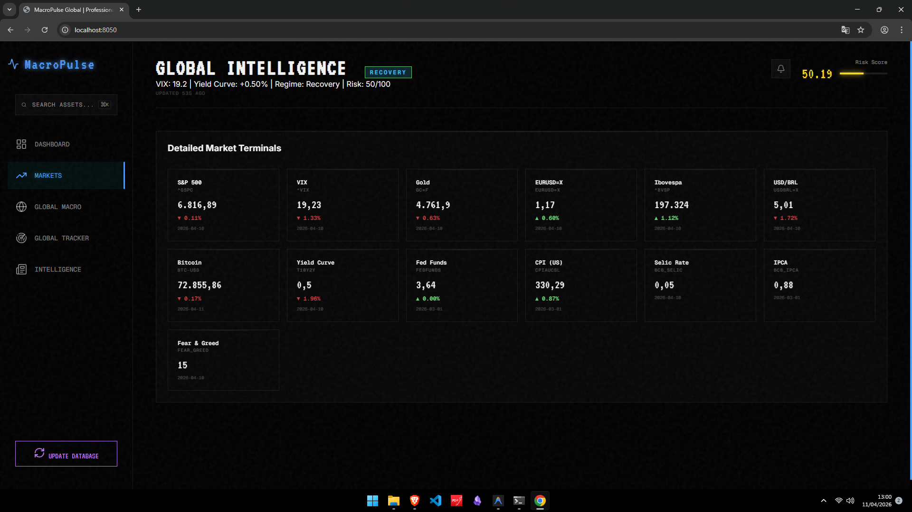
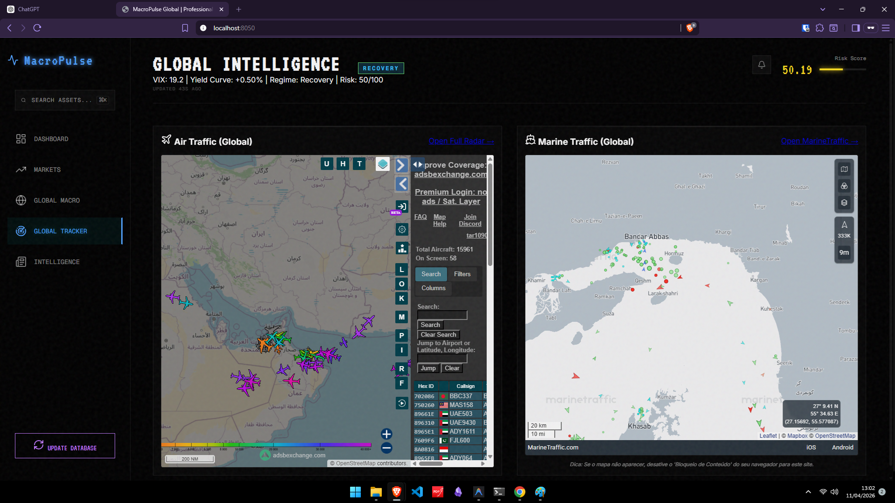
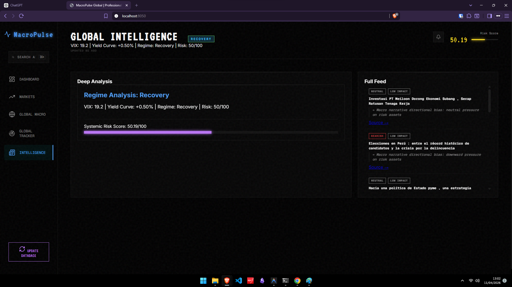

<div align="center">

# MacroPulse Intelligence Platform



**A real-time macroeconomic intelligence terminal that transforms global data into actionable investment signals.**

MacroPulse is a unified macro engine that aggregates global markets, macroeconomic indicators, real-world activity, and news sentiment into a single decision layer — delivering regime detection, dynamic risk scoring, and data-interpolated thesis generation for professional decision-making.

[](.)
[](.)
[](.)
[](.)

</div>

---

## 🧭 The Problem

Global macro data is fragmented across incompatible sources, formats, and update cycles:

- **Market data** (equities, crypto, FX) arrives in real-time ticks
- **Macroeconomic indicators** (rates, inflation, yield curves) update monthly or daily
- **Real-world signals** (logistics, aviation activity) are buried in raw APIs
- **News sentiment** requires NLP interpretation to become tradeable

This fragmentation leads to **delayed, inconsistent, and context-free decision-making** — forcing analysts to manually reconcile data from 10+ sources before forming a single view.

---

## Why This Matters

Macro decisions drive trillions in capital allocation.

Yet most investors operate with fragmented, delayed, or noisy data.

MacroPulse compresses this complexity into a single decision layer.

---

## 💡 The Solution

MacroPulse solves this with a **Unified Intelligence Layer** that:

- Synchronises all data sources into a single canonical timeline
- Computes a real-time composite **Risk Score** with dynamic, regime-aware weights
- Detects the current **Market Regime** (Expansion → Recession) automatically
- Generates a multi-paragraph **Macro Thesis** from raw data — no human interpretation required
- Surfaces **Proactive Alerts** when critical macro signal combinations are detected
- Provides **Actionable Positioning** (Risk-On / Risk-Off / Defensive) as a direct output

> The goal is not to show data. **The goal is to generate insight.**

### Example Alert

🔴 CRITICAL — Systemic Stress Detected  
VIX: 32 | Yield Curve: -0.75%

→ Historical pattern consistent with recession onset

---

### 🖥️ Interface Overview

The following core views provide everything from a high-level macroeconomic panorama to granular market signals.

#### 1. Global Macro Dashboard

*Central monitoring of leading indicators, yield curves, and global inflation, enabling the automated identification of the current economic regime.*

#### 2. Market Analytics

*Real-time visualization of core market indicators across Equities, FX, and Crypto, featuring volatility tracking and statistical mean deviation.*

#### 3. Global Activity Tracker

*Real-world activity monitoring via live iframes for aviation (FlightRadar24) and maritime shipping, providing raw data to validate global growth theses.*

#### 4. Intelligence & Sentiment Feed

*AI-driven insight engine that processes real-time News APIs through LLMs to generate sentiment scores and proactive macroeconomic alerts.*

---
## How It Works (TL;DR)

1. ETL ingests global macro + market + activity data  
2. Data is normalized and stored locally  
3. Intelligence Engine computes risk, regime, and signals  
4. Thesis Engine generates macro interpretation  
5. Frontend displays actionable insights in real-time  

---
## ✨ Core Features

| Feature | Description |
|---|---|
| 🌍 **Unified Global Dashboard** | All macro, market, and EM data on a single screen |
| ⚠️ **Dynamic Risk Score Engine** | Composite 0-100 score with regime-calibrated weights |
| 🧠 **Macro Thesis Generator** | Data-interpolated research narrative, not generic labels |
| 🔄 **Market Regime Detection** | 5-state classifier: Expansion, Recovery, Overheating, Stagflation, Recession |
| 📊 **Risk Breakdown Transparency** | Full component-level attribution displayed in the UI |
| 🚨 **Proactive Alert System** | 6 rule-based triggers (VIX spike, yield inversion, BRL stress, etc.) |
| 🛩️ **Real-World Activity Tracking** | Aviation & maritime data as global trade proxies |
| 📰 **Intelligence News Feed** | Sentiment + causal implication + HIGH/MEDIUM/LOW impact scoring |
| 🇧🇷 **Brazil Macro Intelligence** | Selic, IPCA, Ibovespa, USD/BRL, Fear & Greed |
| 🔗 **Cross-Asset Correlation Engine** | Detects anomalies in historical relationships (e.g. VIX vs. Equities) |
| 🔍 **Local Asset Search** | Instant fuzzy search across all loaded series — zero API calls |
| 🕰️ **Historical Backtesting** | Validates Risk Engine against 2008, 2020, and 2022 crises |
| ⏱️ **Automated ETL Scheduler** | APScheduler runs ETL every 30 min — Celery-migration-ready |

---

## 🏗 Architecture

```
┌─────────────────────────────────────────────────────────────┐
│                      DATA SOURCES                           │
│  Yahoo Finance │ FRED │ BCB (SGS) │ OpenSky │ GDELT/NewsAPI │
└────────────────────────────┬────────────────────────────────┘
                             │
                             ▼
┌─────────────────────────────────────────────────────────────┐
│                    ETL WORKER LAYER                         │
│          backend/workers/etl_worker.py (APScheduler)        │
│  • Fetches all sources in parallel                          │
│  • Validates & normalises (drops NaN, correct date types)   │
│  • Runs Intelligence Engine                                 │
│  • Evaluates alert conditions                               │
│  • Persists to DB + updates shared cache                    │
└────────────────────────────┬────────────────────────────────┘
                             │
              ┌──────────────┴──────────────┐
              ▼                             ▼
┌─────────────────────┐       ┌─────────────────────────────┐
│  SQLite / PostgreSQL│       │    In-Memory Cache          │
│  time_series_data   │       │  (Redis-ready interface)    │
│  macro_status       │       │  backend/api/cache.py       │
└─────────────────────┘       └──────────────┬──────────────┘
                                             │
                                             ▼
                              ┌─────────────────────────────┐
                              │   FastAPI — READ ONLY        │
                              │   backend/api/main.py        │
                              │   /intelligence/global       │
                              │   /timeseries/global         │
                              │   /backtest                  │
                              └──────────────┬──────────────┘
                                             │
                                             ▼
                              ┌─────────────────────────────┐
                              │   Frontend Terminal UI       │
                              │   Cyberpunk aesthetic        │
                              │   Vanilla JS + Alpine.js     │
                              │   TradingView Charts         │
                              └─────────────────────────────┘
```

**Key architectural principle**: The ETL worker is the **only** layer that touches external APIs and mutates state. The FastAPI layer is strictly read-only — ensuring deterministic, low-latency responses.

---

## Differentiation

| Capability | MacroPulse | Traditional Dashboards |
|------------|------------|------------------------|
| Data aggregation | ✅ | ✅ |
| Real-time synthesis | ✅ | ❌ |
| Regime detection | ✅ | ❌ |
| Actionable positioning | ✅ | ❌ |
| Automated thesis generation | ✅ | ❌ |

--- 
## 🛠 Tech Stack

### Backend
| Component | Technology |
|---|---|
| API Framework | FastAPI (async, OpenAPI docs built-in) |
| ORM | SQLAlchemy |
| Scheduler | APScheduler (Celery-migration-ready) |
| Language | Python 3.11+ |

### Data Pipeline
| Source | Data |
|---|---|
| [Yahoo Finance](https://finance.yahoo.com) (`yfinance`) | Equities, crypto, FX, volatility |
| [FRED](https://fred.stlouisfed.org) (`fredapi`) | Fed Funds rate, CPI, T10Y2Y yield spread |
| [Banco Central do Brasil](https://www.bcb.gov.br/estatisticas/tabelaestatisticas) | Selic rate, IPCA inflation |
| [OpenSky Network](https://opensky-network.org) | Real-time aviation activity |
| [GDELT](https://www.gdeltproject.org) / [NewsAPI](https://newsapi.org) | Global news sentiment |
| [Alternative.me](https://alternative.me/crypto/fear-and-greed-index/) | Crypto Fear & Greed Index |

### Frontend
| Component | Technology |
|---|---|
| Core | Vanilla JS (ES6+), HTML5, CSS3 |
| Reactivity | Alpine.js (lightweight state, no build step) |
| Charting | TradingView Lightweight Charts v4 |
| Icons | Lucide Icons |
| Fonts | VT323, Geist Mono, Inter (Google Fonts) |

### Database
| Environment | Database |
|---|---|
| Development | SQLite (zero-config, local) |
| Production | PostgreSQL (swap `DATABASE_URL` in `.env`) |

---

## ⚙️ Key Design Decisions

### 1. ETL / API Strict Separation
The ETL worker (`backend/workers/etl_worker.py`) is the single source of truth for data mutation. The API layer (`backend/api/main.py`) is 100% read-only, serving from cache. This enables independent scaling and eliminates race conditions.

```
ETL Worker  →  DB + Cache  ←  FastAPI (read-only)
```

### 2. Dynamic Regime-Calibrated Weights
Risk Score weights are **not fixed**. They adapt based on the detected market regime:

| Regime | VIX | Macro | Sentiment | Activity |
|---|---|---|---|---|
| Expansion | 25% | 20% | 30% | 25% |
| Recession | **50%** | **35%** | 10% | 5% |
| Overheating | 30% | **40%** | 20% | 10% |
| Stagflation | 35% | 30% | 20% | 15% |
| Recovery | 20% | 20% | 25% | **35%** |

In a Recession, VIX and Macro dominate. In Recovery, physical activity is the leading signal. This mirrors how professional macro desks actually reprice risk.

### 3. Local-First Search
The asset search bar operates entirely on the **locally cached time-series data** — zero extra API calls. Sub-1ms results, instant navigation, and resilience to network outages.

### 4. Annualised Indicators
The BCB delivers Selic as a daily rate. MacroPulse automatically annualises: `((1 + r/100)^252 - 1) × 100`. This ensures all rates are comparable and human-readable for professional users.

### 5. Heuristic Thesis Engine (LLM-Ready)
`build_macro_thesis()` is deterministic — no external AI calls, no latency, no hallucinations. But the function signature is designed for a **drop-in LLM replacement**: pass the structured data dict to any LLM API and return its output. Interpretability is maintained.

### Example Output

"Liquidity tightening combined with declining aviation activity suggests
early-stage industrial slowdown, despite stable equity markets. Risk remains
moderate but skewed to the downside."

### 6. NaN-Safe Persistence
Multi-source ETL inevitably produces sparse series (weekends, holidays, different update cadences). MacroPulse drops all `NaN` rows before DB insert and logs the count — preventing `NOT NULL` constraint failures silently.

---

## Philosophy

- Data without context is noise  
- Indicators without synthesis are useless  
- Speed without structure leads to bad decisions  

MacroPulse exists to solve all three.

---

## 🧠 Intelligence Engine

### Risk Score Composition

The composite Risk Score (0–100) aggregates four components, each scaled to 0–100 before weighting:

```
Risk Score = (VIX_score × w_vix) + (Yield_score × w_yield)
           + (Sentiment_score × w_sent) + (Activity_score × w_act)
```

| Component | Raw Signal | Risk Logic |
|---|---|---|
| **Volatility (VIX)** | CBOE VIX Index | Higher VIX → higher risk. Capped at VIX=50 → 100 |
| **Economic Inversion** | T10Y–T2Y spread | Negative spread → inversion → higher risk |
| **News Sentiment** | Bullish % of articles | Low bullish % → higher risk |
| **Physical Activity** | Flight/vessel counts | Lower activity → higher supply chain risk |

### Market Regime Detection

Two-factor classifier — S&P 500 momentum × VIX level:

| Regime | VIX | S&P 500 Return | Positioning |
|---|---|---|---|
| **Expansion** | < 15 | Positive | 🟢 Risk-On — overweight equities, crypto |
| **Recovery** | < 20 | Negative | 🔵 Accumulation — value stocks, high-yield |
| **Overheating** | > 20 | Positive | 🟡 Cautious — commodities, inflation hedge |
| **Stagflation** | > 20 | Negative | 🟠 Hedge — gold, TIPS, real assets |
| **Recession** | ≥ 25 | Negative | 🔴 Risk-Off — Treasuries, USD cash |

### Alert Conditions

Six rule-based triggers, evaluated on every ETL run:

| Alert | Condition | Severity |
|---|---|---|
| Systemic Stress | VIX > 30 **AND** Yield Curve < 0 | 🔴 CRITICAL |
| High Risk Score | Risk Score > 65 | 🟡 WARNING |
| Recession Regime | Regime = Recession | 🟡 WARNING |
| Deep Yield Inversion | T10Y2Y < −0.50% | 🟡 WARNING |
| BRL Weakness | USD/BRL > 5.80 | 🔵 INFO |
| Stagflation Detected | Regime = Stagflation | 🔵 INFO |

---

## 📊 System KPIs

| Metric | Value |
|---|---|
| API Response Time | < 50ms (served from cache) |
| ETL Cycle | Every 30 minutes (configurable) |
| Data Sources | 6 external providers |
| Asset Coverage | 12+ series across 4 asset classes |
| Historical Depth | 2005–present (after backfill) |
| Alert Conditions | 6 rule-based triggers |
| Risk Score | 0–100 composite with full breakdown |
| DB Reliability | NaN-safe insert with logged drops |

---

## 🚀 Quick Start

### Prerequisites
- Python 3.11+
- Git

### 1. Clone & Install

```bash
git clone https://github.com/your-username/MarcopPulse.git
cd MacroPulse
python -m venv .venv
.venv\Scripts\activate  # Windows
# source .venv/bin/activate  # macOS/Linux
pip install -r requirements.txt
uvicorn backend.api.main:app --reload
```

### 2. Configure Environment

Create a `.env` file in the project root:

```env
# Required for news intelligence (get free key at newsapi.org)
NEWS_API_KEY=your_newsapi_key

# Required for US macro data (get free key at fred.stlouisfed.org)
FRED_API_KEY=your_fred_key

# Optional — for real aviation data (opensky-network.org)
OPENSKY_USERNAME=your_username
OPENSKY_PASSWORD=your_password
```

> **Note:** The platform works without all keys. Missing keys gracefully fall back to alternative sources or cached data.

### 3. Start the Backend

```bash
uvicorn backend.api.main:app --reload
```

The ETL scheduler starts automatically and runs every 30 minutes. On first startup, the cache is warmed from the database.

### 4. Backfill Historical Data (Run Once)

```bash
# POST request — fills DB with 2005-present data (covers 2008 & 2020 crises)
curl -X POST http://localhost:8000/etl/historical-ingest
```

### 5. Open the Frontend

Open `frontend/index.html` in your browser via Live Server (VS Code) or any static server.

```bash
# Or use Python's built-in server
python -m http.server 8080 --directory frontend
# Visit: http://localhost:8080
```

### 6. Trigger ETL Manually (Optional)

```bash
# Runs immediately in background — doesn't block response
curl -X POST http://localhost:8000/etl/run
```

---

## 🧪 Testing & Diagnostics

### Validate the Risk Engine

After ingesting historical data, validate the engine against known crises:

```bash
curl http://localhost:8000/backtest
```

Expected response:

```json
{
  "summary": {
    "total_events": 4,
    "passed": 4,
    "accuracy_pct": 100.0
  },
  "results": [
    {
      "event": "2008 Financial Crisis",
      "verdict": "PASS",
      "avg_risk_score": 71.4,
      "peak_risk_score": 89.2
    },
    {
      "event": "2020 COVID-19 Crash",
      "verdict": "PASS",
      "avg_risk_score": 68.1
    }
  ]
}
```

### API Health Check

```bash
# Intelligence snapshot
curl http://localhost:8000/intelligence/global

# Time-series data
curl http://localhost:8000/timeseries/global

# Swagger docs
open http://localhost:8000/docs
```

---

## 📈 Backtesting

MacroPulse validates its Risk Engine against four historical reference events:

| Event | Period | Expected Signal |
|---|---|---|
| **2008 Financial Crisis** | Sep 2008 – Mar 2009 | Risk Score ≥ 60 · Recession Regime |
| **2020 COVID-19 Crash** | Feb 2020 – Apr 2020 | Risk Score ≥ 65 · Recession Regime |
| **2022 Fed Rate Shock** | Mar 2022 – Oct 2022 | Risk Score ≥ 50 · Overheating Regime |
| **2019 Bull Market** | Jan 2019 – Dec 2019 | Risk Score ≤ 35 · Expansion Regime |

The backtester runs the full `calculate_global_risk_index()` pipeline on each historical day and scores the result against expected thresholds — ensuring the model has genuine predictive power, not just retrospective curve-fitting.

---

## 🗺️ Roadmap

### ✅ Completed
- [x] Unified Global ETL pipeline
- [x] Dynamic regime-calibrated Risk Score
- [x] 5-state Market Regime Detection
- [x] Data-interpolated Macro Thesis Engine
- [x] Proactive Alert System (6 conditions)
- [x] APScheduler background ETL (Celery-ready)
- [x] Cross-asset correlation anomaly detection
- [x] Historical ingestion (2005–present)
- [x] Backtesting engine (4 crisis events)
- [x] Alpine.js reactive UI
- [x] News feed with HIGH/MEDIUM/LOW impact scoring
- [x] Local asset search (instant, zero-latency)
- [x] Brazil Macro integration (BCB API)

### 🚧 In Progress / Planned
- [ ] **LLM Integration** — OpenAI/Gemini for generative research reports (interface already defined)
- [ ] **Celery + Redis** — Production task queue migration (migration path documented in code)
- [ ] **PostgreSQL** — Production database (one config change)
- [ ] **Risk Score Sparkline** — 7-day trend mini-chart
- [ ] **WebSocket Real-time Feed** — Push updates instead of polling
- [ ] **User Watchlists** — Saved asset sets per user
- [ ] **Export to PDF** — Research report download

---

## 👥 Use Cases

| User | Use Case |
|---|---|
| **Macro Trader** | Real-time regime signal to size equity/bond exposure |
| **Quantitative Researcher** | Cross-asset correlation data and risk factor decomposition |
| **Hedge Fund Analyst** | Morning briefing — thesis + positioning from a single terminal |
| **Retail Investor** | Understand whether markets are risk-on or risk-off without reading 10 reports |
| **EM Specialist** | Brazil-specific macro metrics (Selic, IPCA, BRL) integrated with global context |

---

## 🌐 Vision

MacroPulse aims to become a next-generation **open-source macro intelligence terminal** — bridging the gap between raw data and decision-making for professional and retail users alike.

Bloomberg Terminal costs $24,000/year. MacroPulse is not a dashboard.

It is an attempt to democratize macro intelligence —
bringing institutional-grade analysis to anyone with a browser.

The thesis is simple: **macro intelligence should not require a Bloomberg subscription.** With modern APIs, deterministic ML, and a well-designed pipeline, the same quality of market regime analysis is achievable at zero marginal cost.

The next frontier is **AI-augmented synthesis** — where the heuristic thesis engine is enhanced by LLMs, enabling the platform to generate full-length, contextually-aware research reports indistinguishable from those written by senior macro analysts.

---

## 📁 Project Structure

```
MacroPulse/
├── backend/
│   ├── api/
│   │   ├── main.py           # FastAPI — read-only API layer
│   │   ├── cache.py          # Shared in-memory cache (Redis-ready)
│   │   └── schemas.py        # Pydantic response models
│   ├── db/
│   │   ├── database.py       # SQLAlchemy session management
│   │   └── models.py         # TimeSeriesData, MacroStatus
│   ├── etl/
│   │   ├── global_macro.py   # Yahoo Finance + FRED data fetch
│   │   ├── news_engine.py    # GDELT/NewsAPI + impact scoring
│   │   ├── activity_tracking.py  # OpenSky aviation data
│   │   ├── historical_ingest.py  # 2005-present backfill script
│   │   └── load.py           # NaN-safe DB persistence
│   ├── services/
│   │   ├── macro_intelligence.py  # Risk Score + Regime + Thesis
│   │   ├── alert_engine.py        # 6 proactive alert conditions
│   │   ├── correlation.py         # Cross-asset anomaly detection
│   │   └── backtest_engine.py     # Historical crisis validation
│   └── workers/
│       ├── etl_worker.py     # APScheduler background ETL
│       └── __init__.py
├── frontend/
│   ├── index.html            # Terminal UI structure
│   ├── style.css             # Cyberpunk theme + animations
│   └── app.js                # Fetch, state, charts, search
├── instructions.ai           # Living architecture document
├── requirements.txt
├── .env.example
└── README.md
```

---

## 📄 License

MIT License — free to use, modify, and distribute.

---

## 🙏 Credits & Data Providers

| Provider | Data | Link |
|---|---|---|
| Yahoo Finance | Market prices, crypto, FX | [yfinance](https://github.com/ranaroussi/yfinance) |
| FRED | US macro indicators | [fred.stlouisfed.org](https://fred.stlouisfed.org) |
| Banco Central do Brasil | Selic, IPCA | [bcb.gov.br](https://www.bcb.gov.br) |
| OpenSky Network | Aviation activity | [opensky-network.org](https://opensky-network.org) |
| GDELT Project | Global news | [gdeltproject.org](https://www.gdeltproject.org) |
| NewsAPI | English news | [newsapi.org](https://newsapi.org) |
| Alternative.me | Fear & Greed Index | [alternative.me](https://alternative.me/crypto/fear-and-greed-index/) |
| TradingView | Lightweight Charts | [github](https://github.com/tradingview/lightweight-charts) |
| Alpine.js | Reactive UI | [alpinejs.dev](https://alpinejs.dev) |

---

<div align="center">

**Built by a macro-obsessed developer who believes insight should be accessible.**

*MacroPulse — From Data to Decision.*

</div>